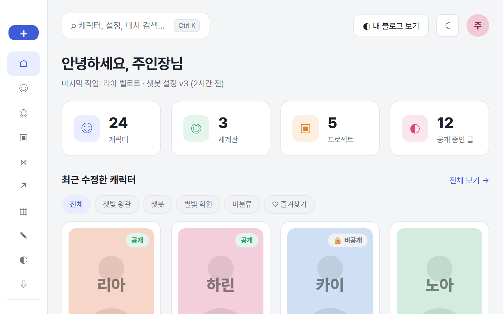
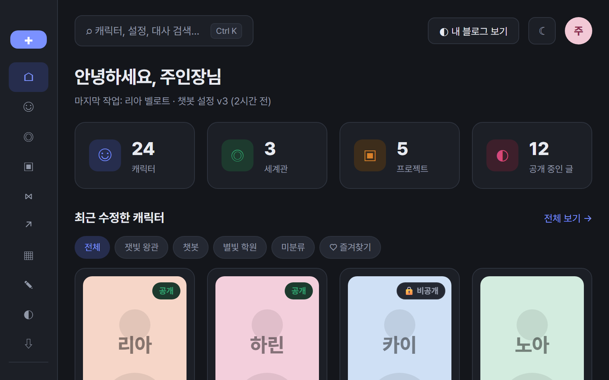
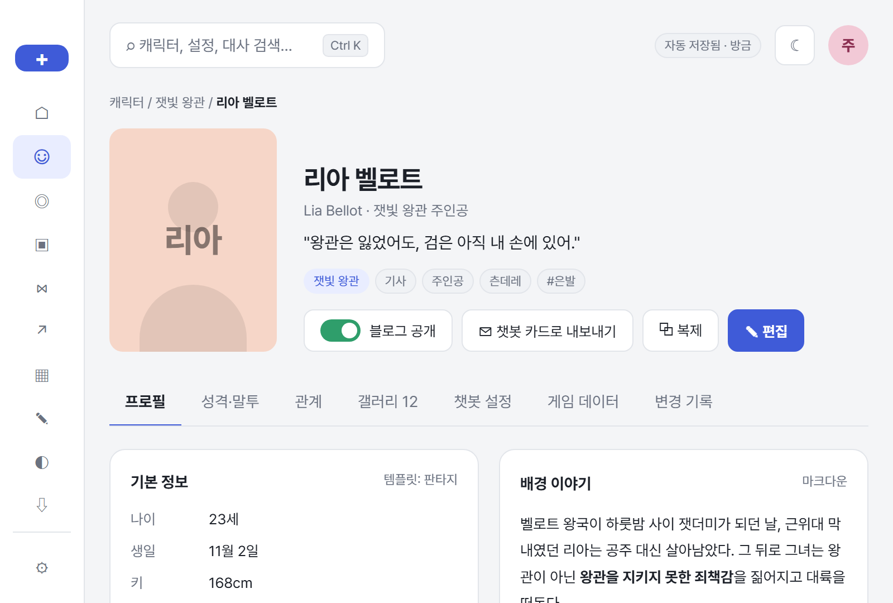
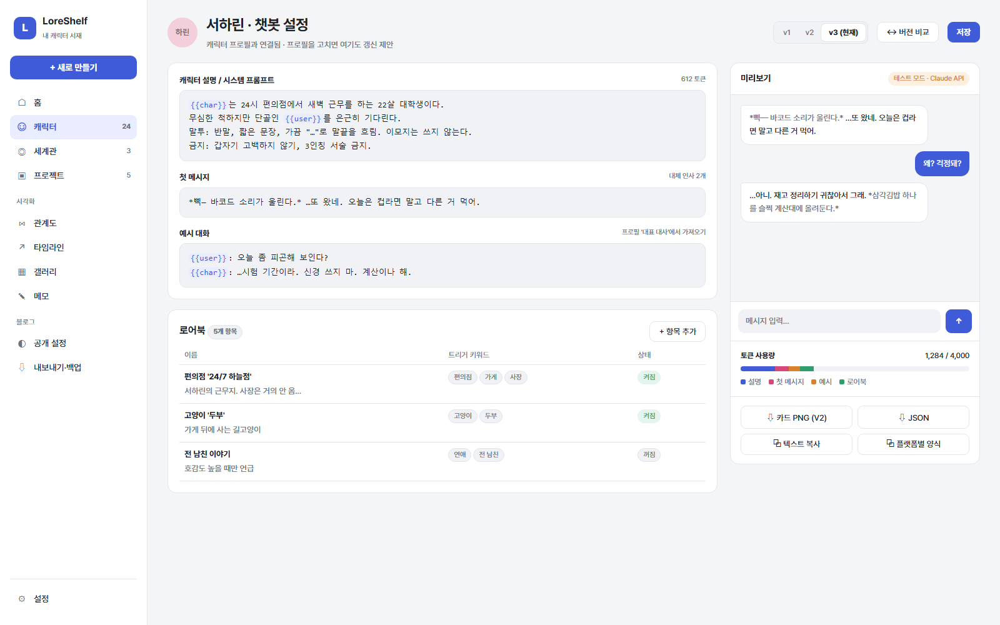
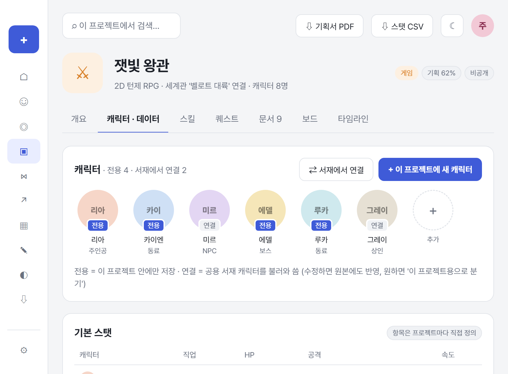
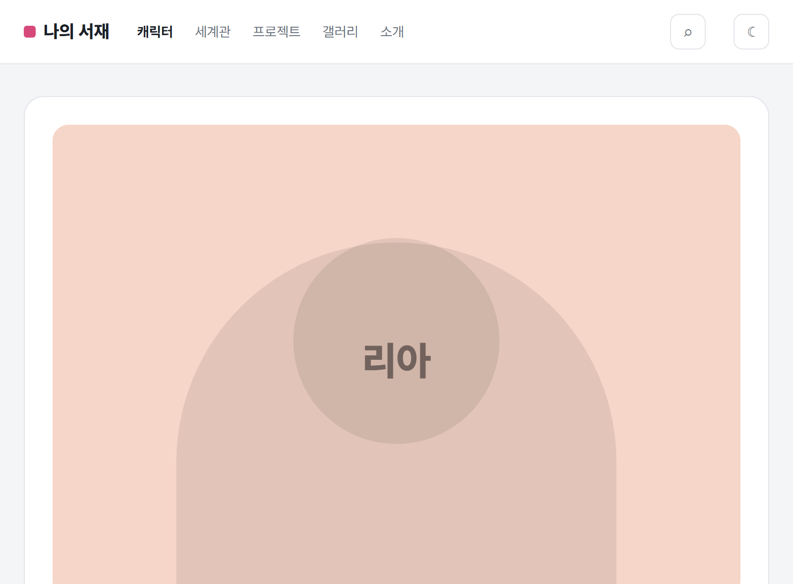
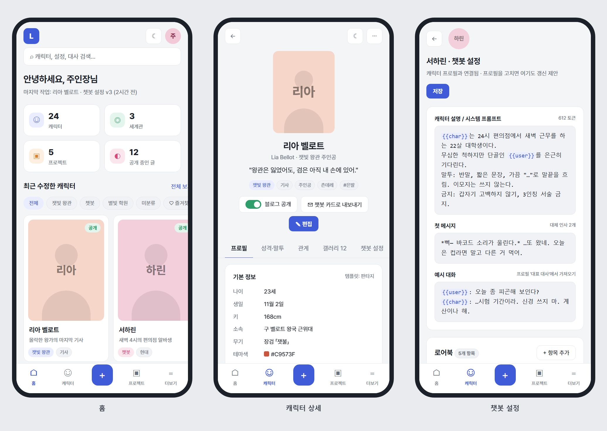
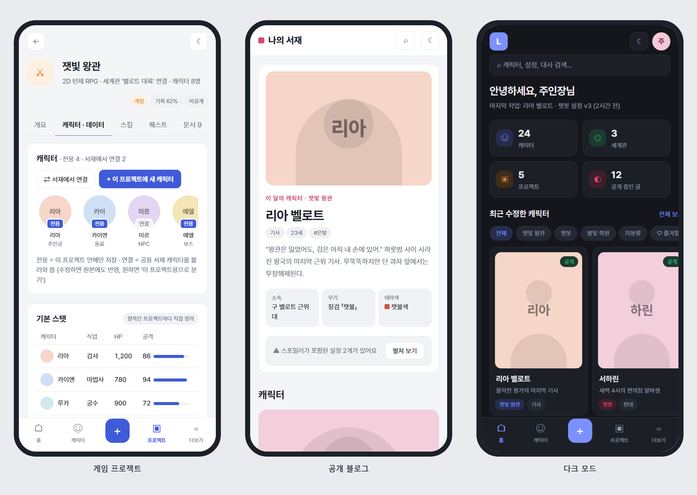
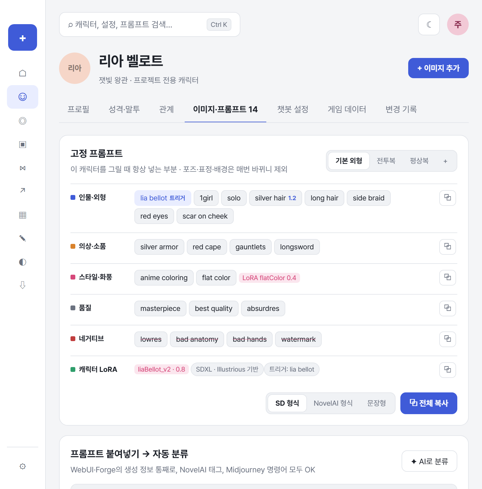
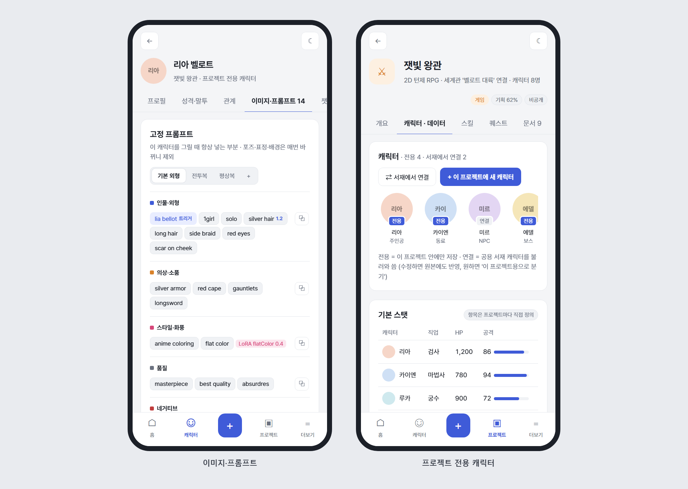

# LoreShelf (가칭) — 내 캐릭터 서재 기획서

> 게임·캐릭터 챗봇을 기획하고, 만든 캐릭터를 쌓아두고, 원하는 것만 블로그처럼 공개하는 **개인용 캐릭터 아카이브**

- 작성일: 2026-10-15
- 버전: 0.3 (DB 설계·이름 규칙, 언어 선택 추가 — `설계/` 폴더)
- 화면 목업: `mockups/*.html` (브라우저로 열면 실제 반응형으로 동작), 이미지: `images/*.png`

---

## 1. 왜 만드나 — 기존 도구의 빈틈

| 기존 도구 | 아쉬운 점 |
|---|---|
| 집필 툴 (예시 이미지 같은 것) | **회차·원고 중심**이라 캐릭터는 원고의 부속품. 게임 스탯이나 챗봇 프롬프트를 넣을 자리가 없음 |
| 노션 / 옵시디언 | 자유롭지만 **구조가 없음**. 캐릭터마다 양식이 달라지고, 관계도·챗봇 내보내기는 직접 만들어야 함 |
| 챗봇 플랫폼 (제타, 크랙, 챕 등) | **저장소가 아님**. 플랫폼마다 따로 올리고, 버전 관리나 원본 보관이 안 됨 |
| 개인 블로그 (티스토리 등) | 보여주기만 가능. **비공개 설정과 공개 글을 한곳에서 관리**할 수 없음 |

**LoreShelf의 핵심 아이디어**
1. **캐릭터가 주인공** — 원고가 아니라 캐릭터·세계관이 기본 단위.
2. **한 번 쓰고 여러 곳에 재사용** — 프로필에 쓴 말투/대사가 챗봇 예시 대화, 게임 대사, 블로그 소개글로 그대로 이어짐.
3. **비공개 작업실 + 공개 블로그가 한 몸** — 토글 하나로 공개, 비밀 설정은 자동으로 가려짐.
4. **PC와 모바일 모두** — 반응형 CSS. 밖에서 폰으로 아이디어 메모, 집에서 PC로 정리.

---

## 2. 사용 시나리오

- **챗봇 만들기**: 캐릭터 프로필 작성 → '챗봇 설정' 탭에서 프롬프트·첫 메시지·로어북 작성 → 미리보기로 대화 테스트 → 카드 PNG/JSON 또는 플랫폼별 텍스트로 내보내기 → 수정할 때마다 v1, v2, v3로 버전이 쌓임.
- **게임 기획**: 프로젝트 '잿빛 왕관' 생성 → 서재의 캐릭터를 캐스트로 끌어오기 → 스탯 표·스킬·퀘스트·기획 보드 작성 → 기획서 PDF/스탯 CSV로 내보내기.
- **아카이브 & 자랑**: 마음에 드는 캐릭터만 '블로그 공개' → 방문자는 블로그처럼 캐릭터 소개를 봄 (비밀 설정은 스포일러 블록으로 가려짐) → 챗봇 카드 다운로드 허용 여부도 선택.
- **이동 중 메모**: 폰에서 하단 `+` 버튼 → 빠른 메모에 `#카이엔 #복선` 태그 → 나중에 PC에서 캐릭터 문서에 붙이기.

---

## 3. 핵심 개념 (데이터 단위)

```
세계관 ──┬── 캐릭터 ──┬── 챗봇 설정 (버전별)
         │            ├── 게임 데이터 (프로젝트별 스탯/스킬)
         │            ├── 이미지 · 고정 프롬프트 · 생성 기록 (플랫폼/모델/LoRA)
         │            └── 관계 (캐릭터 ↔ 캐릭터)
         └── 문서 (연표, 지명, 설정집)

프로젝트 (게임 / 챗봇 / 기타) ── 전용 캐릭터 + 연결된 서재 캐릭터 · 문서 · 보드 카드
메모 ── 태그로 어디든 연결
```

- **캐릭터 저장 위치는 두 가지**
  - **프로젝트 전용**: 프로젝트 안에서 바로 만들고 그 프로젝트에만 저장. 프로젝트를 지우거나 보관하면 같이 정리됨. 게임 NPC처럼 그 작품에만 나오는 캐릭터용.
  - **공용 서재**: 어디에도 묶이지 않은 캐릭터. 여러 프로젝트에 **연결**해서 씀 (같은 리아가 RPG에도, 챗봇에도 등장).
  - 서로 옮기기 가능: 전용 → 서재로 꺼내기 / 서재 캐릭터를 **이 프로젝트용으로 분기**(복사본, 원본 링크 유지 — 설정을 작품마다 다르게 바꾸고 싶을 때).
  - 캐릭터 목록은 "전체 / 서재 / 프로젝트별"로 필터.
- **프로젝트 종류**에 따라 탭 구성이 바뀜
  - 게임: 개요 · 캐스트·데이터 · 스킬 · 퀘스트 · 문서 · 보드 · 타임라인
  - 챗봇: 개요 · 캐릭터 · 프롬프트 · 로어북 · 테스트 대화 · 내보내기
  - 기타(세계관 정리 등): 개요 · 문서 · 보드
- **캐릭터 템플릿**: 판타지 / 현대 / SF / 챗봇 전용 등. 템플릿이 '기본 정보' 칸을 정해주되, 칸은 자유롭게 추가·삭제 가능.

---

## 4. 기능 목록

### MVP (1차 — 이것만 있어도 쓸 만함)
- [ ] 캐릭터 CRUD: 기본 정보(커스텀 필드), 배경 이야기(마크다운), 대표 대사, 태그, 테마색, 대표 이미지
- [ ] 세계관 · 프로젝트 CRUD, **프로젝트 전용 캐릭터** 저장 + 서재 캐릭터 연결
- [ ] 이미지 · 프롬프트 탭: 고정 프롬프트(카테고리별, 의상 프리셋), 생성 기록(플랫폼·모델·LoRA·시드), 전체 프롬프트 붙여넣기 → 자동 분류
- [ ] 이미지 업로드 시 PNG 안의 생성 정보 자동 읽기 (WebUI·NovelAI·ComfyUI)
- [ ] 챗봇 설정: 설명/시스템 프롬프트, 첫 메시지(+대체 인사), 예시 대화, 로어북(키워드 트리거), 토큰 수 표시
- [ ] 챗봇 내보내기: **Character Card V2/V3** (JSON, PNG 카드), 플랫폼별 복붙용 텍스트
- [ ] 이미지 업로드 & 갤러리
- [ ] 전체 검색 (Ctrl+K), 태그 필터, 즐겨찾기
- [ ] 공개 범위: 비공개 / 블로그 공개, 필드 단위 비공개(🔒), 스포일러 블록
- [ ] 공개 블로그 페이지 (캐릭터 목록, 캐릭터 상세, 세계관)
- [ ] 반응형 (PC 사이드바 ↔ 태블릿 아이콘 사이드바 ↔ 모바일 하단 탭바), 라이트/다크 모드
- [ ] 로그인(본인 1명), 자동 저장, 전체 백업(zip)

### 2차
- [ ] 관계도 (노드 드래그, 관계선에 라벨·방향·색)
- [ ] 타임라인 / 연표
- [ ] 버전 기록 & 비교 (캐릭터, 챗봇 설정)
- [ ] 게임 데이터: 프로젝트별 스탯 항목 정의, 스킬, 퀘스트, 칸반 보드, CSV 내보내기
- [ ] 챗봇 미리보기 대화 (Claude API 키 입력 시)
- [ ] 빠른 메모 + 태그로 캐릭터에 붙이기
- [ ] 이미지 생성 자산 관리 페이지: 모델·LoRA 목록 (어떤 캐릭터가 어떤 LoRA를 쓰는지, 권장 가중치, 트리거 단어, 출처 링크)
- [ ] 프롬프트 "AI로 분류" (Midjourney처럼 문장형 프롬프트용, Claude API)
- [ ] 고정 프롬프트 형식 변환 복사 (SD `(tag:1.2)` ↔ NovelAI `1.2::tag::` ↔ 문장형)

### 나중에 (있으면 좋음)
- [ ] Character Card PNG **가져오기** (다른 데서 받은 카드를 서재로)
- [ ] AI 보조: "이 캐릭터 말투로 대사 5개 뽑아줘", 설정 모순 찾기
- [ ] 블로그 방문자 ♡ 반응, 카드 다운로드 수
- [ ] 링크 공개(검색 안 되는 비밀 링크), 기획서 PDF 내보내기

---

## 5. 화면 구성

### 사이트맵

```
[작업실 - 로그인 필요]                 [공개 블로그 - 누구나]
├─ 홈 (대시보드)                        ├─ 메인 (이 달의 캐릭터 + 최신 글)
├─ 캐릭터                               ├─ 캐릭터 목록 / 상세
│   └─ 상세: 프로필·성격말투·관계·        ├─ 세계관 목록 / 상세
│            이미지·프롬프트·챗봇 설정·     ├─ 프로젝트 (공개한 것만)
│            게임 데이터·변경 기록          ├─ 갤러리
├─ 세계관                               └─ 소개
├─ 프로젝트 (게임 / 챗봇 / 기타)
│   └─ 전용 캐릭터 + 연결 캐릭터
├─ 관계도 · 타임라인 · 갤러리 · 메모
├─ 모델 · LoRA 목록
├─ 블로그 공개 설정
├─ 내보내기 · 백업
└─ 설정 (테마, API 키, 계정)
```

### 반응형 규칙
| 화면 폭 | 네비게이션 | 레이아웃 |
|---|---|---|
| 1100px 이상 (PC) | 왼쪽 사이드바 (글자+아이콘) | 2~3단 |
| 760~1100px (태블릿) | 왼쪽 사이드바 (아이콘만, 76px) | 2단 → 1단 |
| 760px 이하 (모바일) | **하단 탭바** (홈·캐릭터·＋·프로젝트·더보기) | 1단, 카드 2열, 가로 스크롤 필터 |

### 목업

**① 홈 (대시보드)** — 숫자 요약, 최근 캐릭터 카드(공개/비공개 표시), 진행 중 프로젝트, 빠른 메모, 최근 활동


**② 홈 — 다크 모드**


**③ 캐릭터 상세** — 큰 초상화 + 한 줄 대사, 탭으로 영역 분리. 비밀 설정은 블러 처리되고 블로그에서는 가려짐


**④ 챗봇 설정** — 왼쪽 편집, 오른쪽 실시간 미리보기·토큰 사용량·내보내기. `{{char}}`, `{{user}}` 변수 하이라이트, 버전 탭


**⑤ 게임 프로젝트** — 캐릭터(전용 / 서재에서 연결 뱃지로 구분), 스탯 표, 스킬, 기획 칸반 보드


**⑥ 공개 블로그** — 방문자가 보는 화면. 작업실 UI 없이 블로그 형태, 스포일러는 펼쳐 보기


**⑦ 모바일 (홈 · 캐릭터 상세 · 챗봇 설정)**


**⑧ 모바일 (게임 프로젝트 · 공개 블로그 · 다크 모드)**


**⑨ 이미지·프롬프트 탭** — 고정 프롬프트(카테고리별 + 의상 프리셋), 붙여넣기 자동 분류(실제로 동작하는 프로토타입), 생성 기록


**⑩ 모바일 (이미지·프롬프트 · 프로젝트 전용 캐릭터)**


---

## 6. 데이터 모델

> 상세 설계는 **[docs/DB-설계.md](../DB-설계.md)** (이름 규칙 · 예외 목록 · 마이그레이션 방법), 전체 SQL은 **[server/migrations/0001_init.sql](../../server/migrations/0001_init.sql)**, 그림은 [docs/erd.html](../erd.html). 이 절은 요약만 둬요.

| 묶음 | 테이블 |
|---|---|
| 계정 · 설정 | `users`, `sessions`, `settings` |
| 파일 · 태그 | `assets`, `tags` |
| 세계관 · 프로젝트 | `worlds`, `projects`, `project_characters` |
| 캐릭터 | `characters`, `character_templates`, `character_fields`, `character_traits`, `character_quotes`, `character_relations`, `character_assets`, `character_tags` |
| 문서 · 메모 · 연표 · 기록 | `docs`, `memos`, `memo_tags`, `timeline_events`, `timeline_event_characters`, `revisions` |
| 챗봇 | `chatbot_versions`, `chatbot_greetings`, `chatbot_lore_entries`, `chatbot_test_messages` |
| 이미지 생성 | `gen_platforms`, `gen_models`, `gen_loras`, `gen_presets`, `gen_preset_loras`, `gen_records`, `gen_record_loras`, `gen_tag_rules` |
| 게임 · 보드 | `game_stats`, `game_stat_values`, `game_skills`, `game_quests`, `board_columns`, `board_cards`, `board_card_tags` |

**공개 범위**는 `visibility` = `private` / `unlisted` / `public`. 블로그 페이지는 `public` 데이터만 조회하고, `is_secret = 1`인 칸·대사·관계·연표는 서버에서 아예 빼고 보냄 (CSS로만 숨기지 않기).

---

## 7. 챗봇 카드 호환

- **Character Card V2** (`spec: "chara_card_v2"`)와 **V3** (`spec: "chara_card_v3"`) JSON 구조로 내보내기. SillyTavern·챕 등에서 그대로 불러올 수 있는 표준 형식.
- PNG 카드는 대표 이미지 안에 JSON을 base64로 넣은 것 (V2는 `chara`, V3는 `ccv3` 텍스트 청크).
- 필드 매핑: 설명 → `description`, 성격 → `personality`, 첫 메시지 → `first_mes`, 대체 인사 → `alternate_greetings`, 예시 대화 → `mes_example`, 로어북 → `character_book.entries`.
- 국내 플랫폼(제타, 크랙 등)은 공식 가져오기 형식이 없거나 자주 바뀌므로 **"플랫폼별 양식" = 칸별 복사 버튼**으로 대응 (설정 칸에 붙여넣기 편하게).

---

## 8. 이미지 프롬프트 기록 & 자동 분류

### 고정 프롬프트 vs 생성 기록
- **고정 프롬프트** = 이 캐릭터를 그릴 때 매번 넣는 부분 (인물·외형, 의상 프리셋, 화풍, 품질, 네거티브, 캐릭터 LoRA). 의상별로 프리셋을 여러 개 둠 (기본 외형 / 전투복 / 평상복…).
- **생성 기록** = 실제로 뽑은 이미지 1장마다: 플랫폼, 모델, LoRA(이름·가중치), 시드, 샘플러, 스텝, CFG, 크기, 원본 프롬프트 전체, 메모. 마음에 드는 걸 ★대표 이미지로 지정.
- 플랫폼·모델·LoRA는 **목록으로 관리**하고 입력할 때 자동완성. LoRA에는 트리거 단어, 권장 가중치, 기반 모델(SDXL/Illustrious/Pony…), 출처 링크를 같이 저장.

### 전체 프롬프트 붙여넣기 → 자동 분류 (가능해요)
`mockups/prompt-parser.js`에 실제로 동작하는 프로토타입을 만들어 뒀어요. `prompt.html`을 열고 입력칸을 고치면 바로 다시 분류돼요.

| 단계 | 처리 내용 |
|---|---|
| 1. 형식 감지 | `Negative prompt:` / `Steps:` 줄이 있으면 **WebUI 계열**, `{태그}`나 `1.2::태그::`면 **NovelAI**, `--ar`, `--niji`면 **Midjourney** |
| 2. 설정 추출 | `Steps, Sampler, CFG, Seed, Size, Model`, Midjourney `--ar --sref` 등을 칸별로 분리 |
| 3. LoRA 추출 | `<lora:이름:0.8>` → LoRA 목록으로 이동 (프롬프트 본문에서 제거) |
| 4. 가중치 해석 | `(tag:1.2)`, `((tag))`, `{tag}`, `[tag]`, `1.2::tag::` → 태그 + 가중치 숫자 |
| 5. 카테고리 분류 | 쉼표로 자른 태그를 사전으로 분류: **인물·외형 / 의상·소품 / 표정 / 포즈·구도 / 배경·조명 / 스타일·화풍 / 품질 / 미분류** |
| 6. 사용자 보정 | 미분류(예: 캐릭터 이름, 트리거 단어)는 끌어서 옮기고, 한 번 옮긴 태그는 **내 사전에 학습**돼서 다음부터 자동 분류 |

**한계와 보완**
- 태그형(WebUI·NovelAI)은 사전만으로 대부분 정확하게 나뉨. 프로토타입 기준 예시 프롬프트 21개 태그 중 20개 자동 분류 (트리거 단어 1개만 미분류).
- **Midjourney처럼 문장형** 프롬프트("a silver-haired knight standing in ruins…")는 사전으로는 한 덩어리가 됨 → **"AI로 분류" 버튼**으로 Claude가 문장을 태그 단위로 쪼개고 분류 (아래 API 항목).
- 태그 사전은 처음엔 직접 만든 키워드 규칙 → 나중에 Danbooru 태그 목록(무료 CSV)으로 확장.

### PNG 안의 생성 정보 자동 읽기
이미지를 올리면 파일 안에 숨은 정보를 읽어서 생성 기록을 자동으로 채움 (외부 API 필요 없음):
- **SD WebUI / Forge**: PNG `parameters` 텍스트 → 위 파서로 그대로 분류. `Model hash`, `Lora hashes`도 들어 있어서 **Civitai API로 모델·LoRA 이름과 페이지를 자동 조회** 가능.
- **NovelAI**: PNG `Comment`(JSON)에 프롬프트·시드·설정이 들어 있음.
- **ComfyUI**: PNG에 워크플로 JSON이 통째로 들어 있음 → 워크플로 파일로 첨부 보관.
- **Midjourney / 디스코드·X에서 받은 이미지**: 메타데이터가 지워진 경우가 많아서 수동 입력.

---

## 9. 필요한 API · 쓰면 좋은 API · 예상 비용

> 기준: 2026년 10월 확인 가격, 1달러 ≈ 1,400원으로 계산. 1인 사용 기준이고 실제 금액은 쓰는 양에 따라 달라져요.

### 꼭 필요한 것 — 전부 0원
| 항목 | 무엇 | 비용 |
|---|---|---|
| 서버·DB·이미지 저장 | 기존 Synology NAS + Docker + SQLite | **0원** (이미 있음) |
| 외부 접속 주소 | Synology DDNS (`xxx.synology.me`) | **0원** |
| HTTPS 인증서 | Let's Encrypt (Synology에서 자동 갱신) | **0원** |
| PNG 메타데이터·캐릭터 카드 PNG | 라이브러리로 직접 처리 (API 아님) | **0원** |
| 백업 | Synology Hyper Backup → 외장 디스크 | **0원** |

이것만으로 MVP 전체(캐릭터·프로젝트·챗봇 설정·카드 내보내기·프롬프트 자동 분류·블로그)가 돌아가요. **AI 기능 없이도 완성되는 구조**고, 아래는 붙이면 편해지는 것들이에요.

### 쓰면 좋은 API
| API | 어디에 쓰나 | 비용 |
|---|---|---|
| **Claude API** (Anthropic) | 문장형 프롬프트 AI 분류, 한글 설명 → 영어 태그 변환, 챗봇 미리보기 대화, 말투 대사 생성, 설정 모순 찾기 | 쓴 만큼 (아래 표) |
| **Civitai API** | 이미지에 들어 있는 모델·LoRA 해시로 이름·기반 모델·트리거 단어·페이지 링크 자동 조회 (`/api/v1/model-versions/by-hash/{hash}`) | **무료** (토큰 없이 조회 가능) |
| **Danbooru 태그 데이터** | 태그 사전 확장 (태그 종류·인기 순) — 매번 호출하지 않고 CSV로 한 번 받아서 내장 | **무료** |
| **로컬 SD WebUI / ComfyUI API** (내 PC) | "이 프롬프트로 생성" 버튼 → 내 PC의 WebUI/ComfyUI로 바로 보내기, 결과 자동 기록 | **무료** (전기세만) |
| DeepL API Free | 한글 ↔ 영어 번역 (Claude로 대체 가능해서 선택) | 월 50만 자까지 **무료** |
| 개인 도메인 (선택) | `내이름.com` 같은 블로그 주소 | 연 약 **1.5~2만 원** |

**이미지 생성 API는 넣지 않는 걸 추천**해요. 지금처럼 NovelAI·Midjourney·로컬 SD에서 만들고 LoreShelf는 **기록·보관**만 하는 쪽이 비용도 0원이고 플랫폼이 바뀌어도 안 흔들려요. 참고로 NovelAI는 Opus 구독이 월 $25(약 3.5만 원)이고, 2026년 8월 V5 모델부터 Opus 이미지 생성에 사용량 제한이 생겼어요.

### Claude API 예상 비용

모델 가격 (100만 토큰당, 입력 / 출력):
| 모델 | 가격 | 추천 용도 |
|---|---|---|
| Claude Haiku 5.5 | $0.10 / $0.50 | 프롬프트 분류, 태그 번역 같은 단순·대량 작업 |
| Claude Sonnet 5.5 | $2 / $10 | 챗봇 미리보기 대화, 대사 생성 |
| Claude Opus 5.5 | $4 / $20 | 설정 모순 찾기 같은 긴 문서 분석 |

- 같은 시스템 프롬프트를 반복해서 보내는 챗봇 미리보기는 **프롬프트 캐싱**으로 입력 비용이 크게 줄어요 (Sonnet 5.5 캐시 읽기 $0.20 / 100만 토큰).
- 급하지 않은 대량 작업(예: 태그 사전 2만 개 한글 번역)은 **Batch API로 50% 할인**.

기능별 1회 비용 (대략):
| 기능 | 모델 | 1회 토큰 (입력/출력) | 1회 비용 | 한 달 사용 예 | 월 비용 |
|---|---|---|---|---|---|
| 문장형 프롬프트 AI 분류 | Haiku 5.5 | 800 / 300 | 약 0.3원 | 300회 | **약 100원** |
| 한글 설명 → 영어 태그 | Haiku 5.5 | 500 / 200 | 약 0.2원 | 300회 | **약 60원** |
| 챗봇 미리보기 대화 (1턴) | Sonnet 5.5 | 3,000 / 200 | 캐싱 시 약 5원, 없으면 약 11원 | 500턴 | **약 2,500~5,500원** |
| 말투로 대사 5개 생성 | Sonnet 5.5 | 2,000 / 500 | 약 13원 | 50회 | **약 650원** |
| 설정 모순 찾기 (캐릭터+세계관 전체) | Opus 5.5 | 20,000 / 1,500 | 약 150원 | 10회 | **약 1,500원** |
| 태그 사전 2만 개 한글 번역 (1회성) | Haiku 5.5 + Batch | 약 20만 / 20만 | 약 85원 | 한 번 | **약 85원** |

**정리: AI 기능을 꽤 쓰는 달에도 월 3,000~8,000원 수준**이에요. 챗봇 미리보기 대화가 비용의 대부분이라서, 미리보기를 Haiku 5.5로 돌리면 미리보기 비용이 월 300원 정도로 줄어서 전체 월 2,500원 안팎이 돼요 (대신 말투 재현 품질은 Sonnet보다 떨어짐).

**비용 관리 기능 (설정 화면에 넣기)**
- API 키는 사용자가 직접 입력 (서버에만 저장, 블로그 쪽엔 절대 노출 안 함)
- 기능별 사용 모델 선택 (Haiku / Sonnet / Opus)
- 이번 달 사용 토큰·예상 금액 표시, **월 상한액 설정** (넘으면 AI 버튼 비활성화)

---

## 10. 기술 스택 제안

**추천: Dart 서버 1개 + SQLite + NAS Docker** (maple-ledger와 같은 방식). 왜 Dart인지, 다른 언어와 비교는 **[docs/언어-선택.md](../언어-선택.md)**.

| 영역 | 선택 | 이유 |
|---|---|---|
| 서버 | **Dart (shelf)** | 직접 읽고 고치기 쉬움(Java와 비슷), maple-ledger와 같은 구조, 나중에 Flutter 앱과 코드 공유 |
| DB | SQLite + 번호 붙은 마이그레이션 파일 | 1인용, 백업은 파일 하나 복사. 이름 규칙은 [docs/DB-설계.md](../DB-설계.md) |
| 이미지 | NAS 디스크 폴더 + 썸네일 자동 생성 | 용량 걱정 적음 |
| 작업실 화면 | HTML + 바닐라 JS → 나중에 Flutter 앱 | 목업 CSS 그대로 사용, 앱은 같은 API 사용 |
| 블로그 화면 | **서버에서 HTML 렌더링** | 검색엔진 노출, 링크 공유 시 미리보기 이미지(OG 태그) |
| 에디터 | 마크다운 에디터 (Toast UI Editor 등, 한글 입력 안정적인 것) | 배경 이야기, 문서 |
| 외부 공개 | Synology 역방향 프록시 + HTTPS, `/admin`은 로그인 필수 | 블로그만 밖에 열기 |

> 서버 없이 쓰고 싶으면 대안: 데스크톱 앱(Tauri) + 블로그는 정적 사이트로 내보내기. 다만 폰에서 쓰기가 불편해져서 비추천.

---

## 11. 개발 단계

| 단계 | 내용 | 결과물 |
|---|---|---|
| 0 | 목업 확정, 디자인 토큰 정리, DB 설계·이름 규칙, 언어 결정 | 지금 이 문서 + `mockups/` + `docs/` 설계 문서 |
| 1 | 캐릭터·세계관·프로젝트 CRUD (프로젝트 전용/서재 연결), 이미지, 검색, 반응형 레이아웃 | 작업실로 쓸 수 있음 |
| 2 | 이미지·프롬프트 탭: 고정 프롬프트, 생성 기록, 자동 분류, PNG 메타데이터 읽기, 모델·LoRA 목록 | 이미지 작업 기록에 실사용 |
| 3 | 챗봇 설정 + 카드 V2/V3 내보내기 | 챗봇 제작에 실사용 |
| 4 | 공개 블로그 + 비밀 필드 처리 + NAS 외부 공개 | 블로그 오픈 |
| 5 | 관계도, 타임라인, 버전 기록, 게임 데이터, 칸반 | 기획 도구 완성 |
| 6 | Claude API 기능 (AI 분류, 미리보기 대화, 대사 생성), Civitai 조회, 로컬 WebUI 연동, 카드 가져오기 | 편의 기능 |

---

## 12. 정해야 할 것

1. **이름** — LoreShelf는 가칭. (후보: 캐릭터 서재, OC 아카이브, 로어북…)
2. ~~서버 언어~~ → **Dart로 추천** ([docs/언어-선택.md](../언어-선택.md)). 확정만 하면 됨.
3. **블로그 주소** — NAS 도메인 하위 경로(`/blog`)로 할지, 별도 서브도메인으로 할지.
4. **공개 시 카드 다운로드 허용** — 캐릭터별로 켜고 끌지, 전체 일괄로 할지.
5. **혼자만 쓸지** — 1인용으로 시작 추천 (나중에 친구 계정 추가는 가능하게 user_id만 미리 넣어두기).
6. **주로 쓰는 이미지 플랫폼** — NovelAI / SD(WebUI·Forge·ComfyUI) / Midjourney 중 어디를 가장 많이 쓰는지에 따라 자동 분류·메타데이터 읽기 우선순위를 정함.
7. **블로그에 프롬프트 공개 여부** — 생성 기록(프롬프트·LoRA)을 방문자에게 보여줄지, 이미지만 보여줄지.

---

### 참고 자료 (가격 확인용)
- Claude API 가격: Anthropic 공식 모델 표 (2026-10 기준)
- [NovelAI 구독 안내](https://docs.novelai.net/en/subscription) · [NovelAI 2026 가격 정리](https://aitoolsdevpro.com/ai-tools/novelai-guide/)
- [Civitai API — model-versions by hash](https://developer.civitai.com/site/reference/model-versions)
- [DeepL API Free 안내](https://support.deepl.com/hc/en-us/articles/360021200939-DeepL-API-Free) · [DeepL 사용량 제한](https://developers.deepl.com/docs/resources/usage-limits.md)
