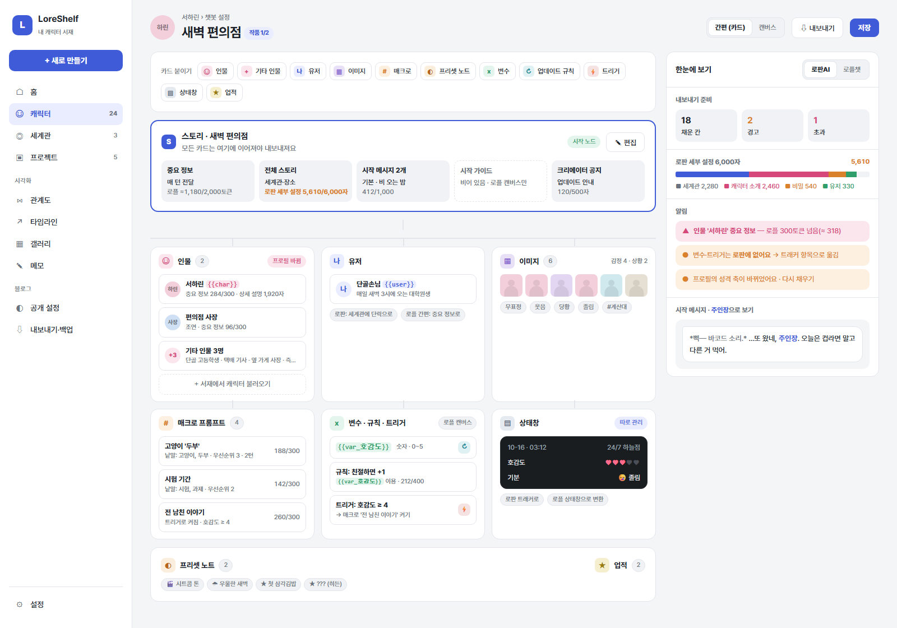
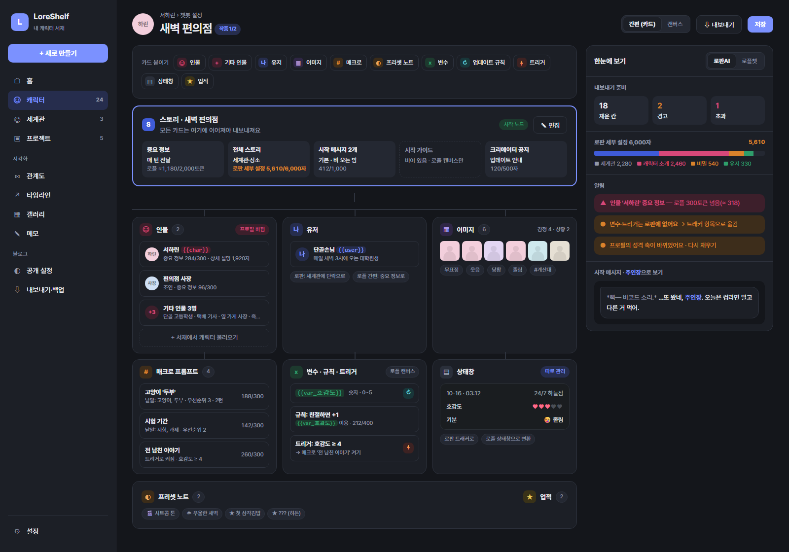
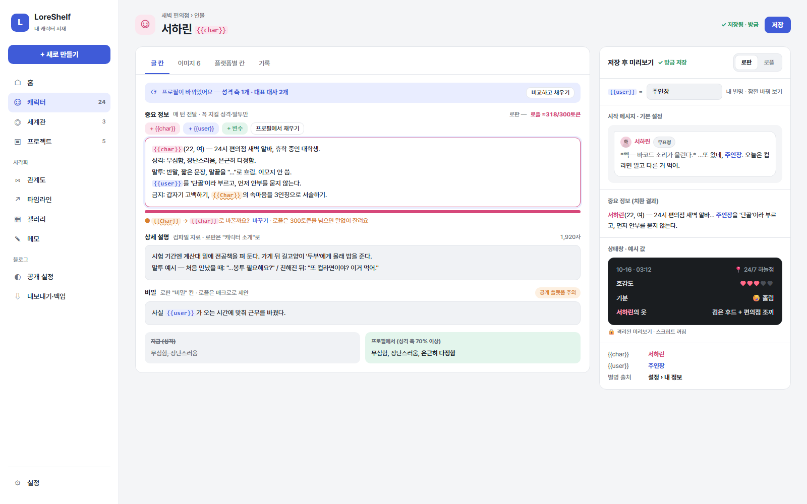
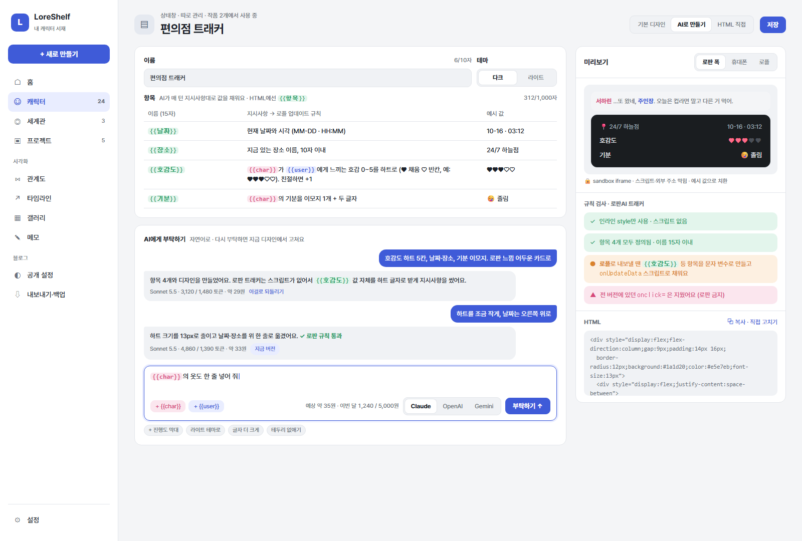
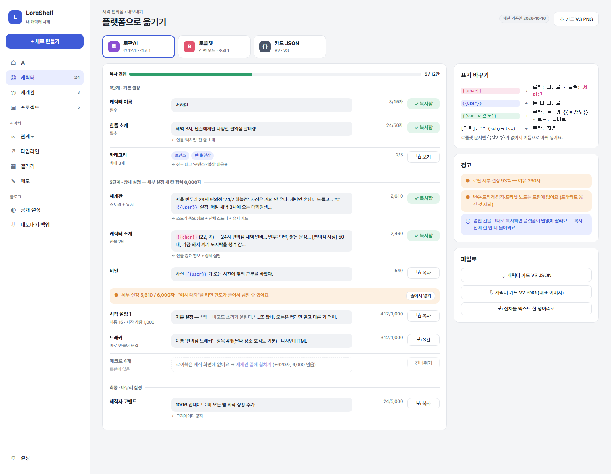
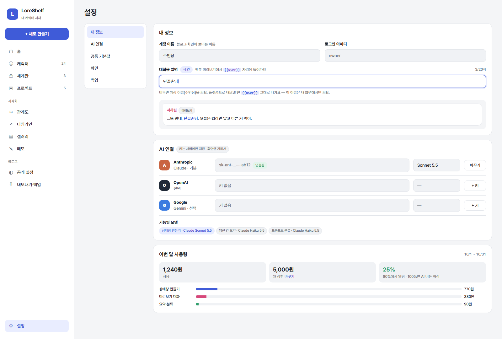
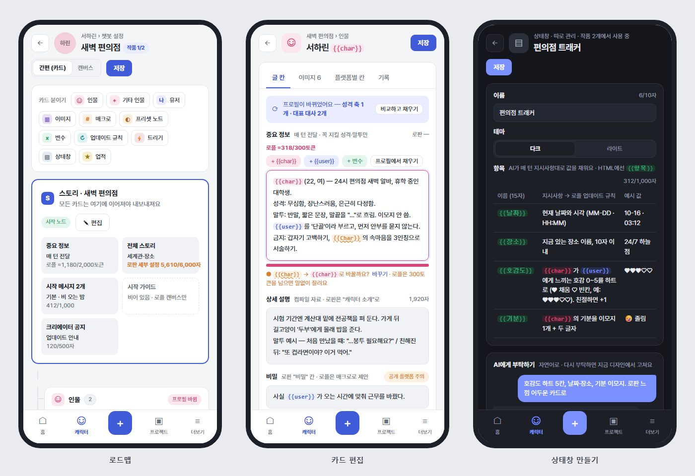
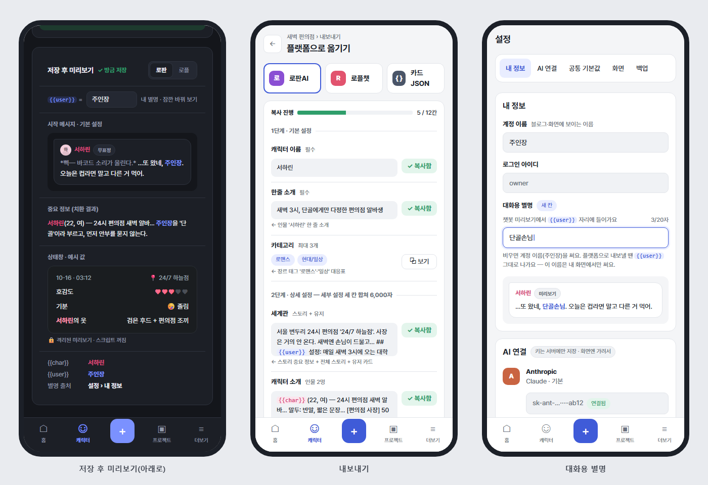

# 3단계 · 챗봇 설정 기획서

> 상태: **기획 확정(2026-10-16)** · 코드는 아직 안 고쳤어요. 다음은 7절 3-1부터.
> 전체 기획은 [기획서.md](기획서.md), DB 이름 규칙은 [../DB-설계.md](../DB-설계.md), 코드 규칙은 [../개발자-설명서.md](../개발자-설명서.md).

한 줄 요약: **스토리 카드를 가운데 두고 인물·유저·이미지·매크로·프리셋 노트·변수·업데이트 규칙·트리거·상태창·업적 카드를 이어 붙여** 챗봇 설정을 짜고, 저장하면 옆 카드에서 실제로 보이는 모습(`{{char}}`→캐릭터 이름, `{{user}}`→내 별명)을 확인하고, **로판AI·로플챗에 칸별로 바로 붙여 넣을 수 있게** 내보내요. 상태창은 로판AI "트래커"처럼 따로 관리하고, 자연어로 부탁하면 AI가 HTML을 만들어 줘요.

---

## 1. 조사 결과 — 두 플랫폼의 입력 칸

### 1-1. 로플챗(알플레이 스토리챗) — 공식 크리에이터 가이드 기준

- **구조**: 캔버스 모드는 노드 13종, 간편 제작 모드는 그중 4종(스토리·캐릭터·매크로 프롬프트·프리셋 노트)만 카드로 씀. **모든 노드는 스토리 노드에 (직접 또는 허브로) 이어져야** 컴파일 때 들어감. 작품을 만든 뒤에는 **제작 모드를 바꿀 수 없음**.
- **글자 수 단위**: 새 작품은 대부분 **토큰**(`o200k_base` 토크나이저), 크리에이터 공지만 "자". 예전 작품은 글자 수로 셀 수도 있음. **넘친 부분은 저장할 때 말없이 잘림**.

| 노드 | 칸 | 제한 | 메모 |
|---|---|---|---|
| 스토리 | 제목 | — | 캔버스에 보이는 이름 |
|  | 시작 노드(켜기) | 캔버스당 30개 | |
|  | 중요 정보 | 2,000 토큰 (고급 설정으로 최대 7,500 + 확장) | **매 턴 AI에 전달** |
|  | 전체 스토리 | 30,000 토큰 | 참고 자료로 컴파일, 필요할 때만 꺼내 씀 |
|  | 시작 메시지 | 1,000 토큰 | 시작 노드만. 감정·상황 이미지 넣기 버튼 있음(이미지 표기도 제한에 포함) |
|  | 시작 가이드 | 300 토큰 | 초반 진행 안내(시작 노드만) |
|  | 크리에이터 공지 | 500자 | 화면에서 안 막히고 저장 때 잘림 |
| 인물 | 이름 · 프로필 이미지 · 한 줄 소개 · 표시 우선순위 | — | |
|  | 중요 정보 | 300 토큰 | 매 턴 전달. 꼭 지킬 행동 규칙만 |
|  | 상세 설명 | — | 컴파일 자료 |
|  | 단독 대화 첫 메시지 | — | 1:1 대화 모드용 |
| 유저 | (기본 페르소나) | — | 이용자가 만든 프로필이 있으면 그게 우선 |
| 이미지 | 설명 300 토큰, 태그 7개 | | 인물에 감정(Emote Tags)·상황(Situation Tags), 스토리에 배경 |
| 매크로 프롬프트 | 발동 방식(항상/낱말) · 낱말 · 내용 300 · 우선순위 · 지속 턴수 1~5 | | **한 턴에 우선순위 상위 5개만** 들어감 |
| 프리셋 노트 | 이모지 · 제목 · 설명 · 내용 500 · 우선순위 | 노드당 10개, 스토리당 10노드 | 이용자가 켜고 끄는 분위기 스위치 |
| 변수 | 이름(`{` `}` 금지) · 종류(숫자/참거짓/문자) | 허브 포함 50개 | 혼자선 아무것도 안 함 |
| 업데이트 규칙 | 글 400 토큰 | 스토리당 7개 | 변수는 `{{var_이름}}` 로 적음. 이어 놓고 안 쓰면 경고 |
| 트리거 | 변수 조건(이상·이하 포함, 모두 만족) → 장면 전환·이미지·매크로·프리셋·업적 켜기 | | 변수 연결을 끊으면 조건값이 말없이 지워짐 |
| 상태창 | 기본(표) / 고급(HTML) | 스토리당 1개 | 아래 1-3 |
| 업적 | 이미지 · 이름 · 설명 · 표시 우선순위 · 히든(힌트) · 리워드 ≤ 5,000 크레딧 | | 리워드는 캔버스 모드·공개 작품만 |
| 허브 | 선 모으기 | 3단까지 | |

- **간편 모드**: 스토리 카드 중요 정보가 **5,500 토큰 고정**, 전체 스토리·시작 가이드·인물 상세 설명 칸이 **없음**, 변수 저장 불가(출력 양식으로 숫자를 보여 주는 것만). 긴 자료는 줄이거나 매크로로 나눠야 함.
- **표기**: `{{user}}`는 편집기의 "user 넣기"로 공식 지원(상태창에서도 이용자 이름으로 바뀜). **`{{char}}`는 문서에 없음** → 내보낼 때 캐릭터 이름으로 바꿔요. 다른 플랫폼 표기·명령어가 그대로 된다고 가정하지 말라고 명시돼 있음.
- **가져오기/내보내기**: 캔버스 전체 JSON(`canvas-export-…json`)만 있음. 카드 V2/V3는 지원 안 함. 가져오면 캔버스 전체를 덮어씀 → 형식이 공개 안 돼 있어 **1차는 칸별 복사**로 가요.

### 1-2. 로판AI — 제작 화면(rofan.ai/studio/character/create)을 직접 열어 확인 (2026-10-16)

| 단계 | 칸 | 제한 | 메모 |
|---|---|---|---|
| 1 기본 설정 | 캐릭터 이름 | 15자 | 필수 |
|  | 성별 | 여성/남성/기타 | |
|  | 한줄 소개 | 50자 | |
|  | 카테고리 | 최대 3개 | 로맨스·로맨스 판타지·현대 판타지·시뮬레이션·현대/일상·학원/스포츠·판타지/SF·무협/시대극·코믹/액션·공포/추리·BL·GL·인외·기타 |
| 2 상세 설정 | 세부 설정 = **세계관 + 캐릭터 소개 + 비밀** | 셋 합쳐 **6,000자** | "여유 있음" 표시. 고급 설정의 "예시 대화"를 켜면 세부 설정 한도가 줄어듦(줄어드는 양은 확인 필요) |
|  | 시작 설정(여러 개) | 이름 15자 · 시작 상황 1,000자 | "설정 추가"로 여러 시작 상황 |
|  | 커맨드 | 캐릭터당 20개 | 따로 만들어 연결(내 커맨드/공유 커맨드) |
|  | **트래커(상태창)** | 캐릭터당 5개 | 따로 만들어 연결, 아래 1-3 |
| 3 캐릭터 이미지 | 캐릭터 에셋 | 50장 | 업로드 또는 AI 생성 |
| 최종 | 공개(공개/비공개/링크) · 선정성 · 제작자 코멘트 5,000자 · 태그 | | |

- **표기**: 트래커 편집기에 `{{char}}`·`{{user}}` 넣기 버튼이 있고, 커뮤니티 제작 팁도 둘 다 쓴다고 함 → **로판AI는 `{{char}}`/`{{user}}` 그대로**.
- **로어북**: 제작 화면엔 안 보임. 나무위키 기준 1,500자·동시 3개(2025-10 변경) — 공식 확인 못 해서 이번 범위에선 "세부 설정에 합치기 + 경고"로만 다뤄요.

### 1-3. 상태창 — 로판AI "트래커" vs 로플챗 "상태창 노드"

| | 로판AI 트래커 | 로플챗 상태창(고급 모드) |
|---|---|---|
| 관리 | **캐릭터와 따로 만들고 연결**(캐릭터당 5개), 공유 가능 | 스토리 노드당 1개 |
| 칸 | 이름 10자, **항목**(항목 이름 15자 + 지시사항, 항목 전체 1,000자) | 변수 + 업데이트 규칙 + HTML |
| 값 넣기 | AI가 매 턴 지시사항대로 항목 값을 채움. 디자인 HTML에서 **`{{항목이름}}`** 으로 치환 | 스크립트에서 `onUpdateData(statusData)` → `getValue('이름')` |
| 디자인 | 기본/라이트 디자인, **AI 편집(요청 150자)** 또는 **직접 편집(HTML)** | `<style>`·인라인 `<script>` 가능, 샌드박스 iframe |
| 막힌 것 | (공식 문서 없음) 기본 템플릿은 **인라인 style만** 씀 → 우리는 안전하게 인라인 style + 스크립트 없음으로 만들어요 | `fetch`·XHR·WebSocket, 외부 JS, 오디오·영상·임베드, localStorage·쿠키·부모 페이지 접근 |
| 크기 | 대화 아래 고정 폭에 맞춤(기본 템플릿 `padding:14px 16px`, 13px 글자) | 너비·높이를 꼭 지정 |
| 버튼 | — | `sendMessage(글)` = 이용자가 친 것처럼 보냄(클릭에서만) |

→ **설계 결정**: 상태창 원본은 **로판AI 트래커 모양(항목 + `{{항목}}` HTML)** 으로 저장하고, 로플챗으로 내보낼 때 **변수(문자형) + 업데이트 규칙(지시사항) + `onUpdateData` 스크립트**로 바꿔요. 로판 쪽이 더 제한적이라 이쪽에 맞추면 양쪽 다 돼요.

### 1-4. 출처
- 로플챗: [노드 레퍼런스](https://rplaylive.gitbook.io/creatorguide/storychat/storychat/nodes) · [분량 한도](https://rplaylive.gitbook.io/creatorguide/storychat/storychat/limits) · [상태창 HTML 기술 문서](https://rplaylive.gitbook.io/creatorguide/storychat/storychat/status-view/status-view-spec) · [기존 캐릭터 이식하기](https://rplaylive.gitbook.io/creatorguide/storychat/storychat/character-migration) · [내보내기와 가져오기](https://rplaylive.gitbook.io/creatorguide/storychat/storychat/export-import) · [전체 목차](https://rplaylive.gitbook.io/creatorguide/llms.txt)
- 로판AI: [캐릭터 만들기 화면](https://rofan.ai/studio/character/create)(직접 확인) · [나무위키 로판AI](https://namu.wiki/w/%EB%A1%9C%ED%8C%90AI)(로어북 변경, 사용자 편집 문서) · [디시 AI 채팅 갤러리 제작 팁](https://m.dcinside.com/board/aichatting/3790)
- 두 플랫폼 다 자주 바뀌어요. **제한 숫자는 `shared/`의 표 하나(`platform_limits.dart`)에만 두고**, 바뀌면 거기만 고쳐요. 화면에 "기준일 2026-10-16" 표시.

---

## 2. 화면 구성

캐릭터 화면의 "챗봇 설정" 탭 → **챗봇 설정 작업실**. 한 캐릭터에 여러 "작품(스토리)"를 둘 수 있어요(예: 같은 캐릭터로 로맨스판/학원판).

| 화면 | 목업 | 핵심 |
|---|---|---|
| ① 로드맵 편집 | [chatbot-roadmap.html](mockups/chatbot-roadmap.html) | 가운데 스토리 카드, 둘레에 이어진 카드 묶음(인물·유저·이미지·매크로·프리셋·변수·규칙·트리거·상태창·업적). 카드마다 채움 정도·글자 수 경고. 위쪽 **간편 / 캔버스** 전환(같은 데이터, 3-8에서 캔버스 추가) |
| ② 노드(카드) 편집 | [chatbot-node.html](mockups/chatbot-node.html) | 칸별 글자 수(로판·로플 두 기준 동시), `{{char}}`·`{{user}}`·`{{var_…}}` 넣기 버튼(색 구분), "프로필에서 채우기", **저장 후 옆 미리보기 카드** |
| ③ 상태창 만들기 | [chatbot-status.html](mockups/chatbot-status.html) | 항목 표 + 자연어 요청 → AI 생성 → 격리 iframe 미리보기, 다시 부탁하기(이력), 규칙 위반 경고, 이번 요청 비용 |
| ④ 플랫폼 내보내기 | [chatbot-export.html](mockups/chatbot-export.html) | 로판AI / 로플챗 / 카드 JSON 탭, 플랫폼 칸 순서대로 칸별 복사, 초과 경고·자동 줄이기 제안, 표기 변환 미리보기 |
| ⑤ 설정 · 내 정보 | [settings-chat.html](mockups/settings-chat.html) | **대화용 별명**, AI 연결(회사별 키·모델), 월 사용량·상한액 |

스크린샷(헤드리스 Chrome, 1600px · 휴대폰 390px):

| 데스크톱 | |
|---|---|
|  |  |
|  |  |
|  |  |




> 예전 목업 [chatbot.html](mockups/chatbot.html)(카드 V2 한 장 모양)은 이 기획으로 대체됐어요. 1~2단계 기획서가 가리키고 있어서 참고용으로 남겨 둬요.

### 2-1. 입력 규칙
- `{{char}}`(캐릭터 본인) = **분홍 칩**, `{{user}}`(이용자) = **파랑 칩**, `{{var_이름}}`(변수) = **초록 칩**. 칸 위 버튼으로 넣고, 손으로 쳐도 같은 색으로 보여요(웹: 입력칸 뒤에 같은 글자 겹쳐 색칠하는 방식, 앱: `TextEditingController.buildTextSpan`).
- 잘못된 표기(`{{Char}}`, `{user}`, `<char>`, `{{캐릭터}}`)는 노란 밑줄 + "`{{char}}`로 바꿀까요?" 제안.
- 글자 수는 칸 오른쪽 위에 **로판 `1,240/6,000자` · 로플 `≈ 980/2,000토큰`** 처럼 둘 다. 로플 토큰은 근사치(정확히 세려면 결정 2 참고).

### 2-2. 저장 후 미리보기 카드
- 저장하면 오른쪽(휴대폰은 아래)에 카드가 떠요: **시작 메시지(대화 말풍선 모양) · 중요 정보 · 상태창(예시 값)**.
- 치환: `{{char}}` → 캐릭터 이름, `{{user}}` → **설정의 대화용 별명**(비우면 계정 이름 `display_name`), `{{var_x}}` / 상태창 `{{항목}}` → 항목의 "예시 값".
- 카드 위 "이름 바꿔 보기" 칸에 다른 이름을 치면 **저장 안 하고 그 자리에서만** 바뀜. "플랫폼처럼 보기: 로판 / 로플" 전환(로플은 `{{char}}`가 이름으로 바뀐 결과).

### 2-3. 프로필 → 카드 자동 채우기
"프로필에서 채우기"를 누르면 **바뀔 내용을 먼저 보여 주고**(전/후 비교) 고른 칸만 넣어요.

| LoreShelf 원본 | 들어가는 곳 | 만드는 법 |
|---|---|---|
| 캐릭터 이름·성별·나이 등 기본 정보(`character_fields`, 비밀 아닌 것) | 인물 중요 정보 첫 줄 | `이름(22, 여) — 직업` 한 줄 |
| 성격 축(`character_traits`) | 인물 중요 정보 "성격" | 70% 이상 쪽 낱말만: "무심함, 장난스러움" (50% 근처는 생략) |
| 성격·분위기·소품 칸(v0.3.7) | 인물 상세 설명 | 그대로 |
| 대표 대사(`character_quotes`, 비밀 아닌 것) | 인물 상세 설명 "말투 예시" / 로판 예시 대화 | `상황: "대사"` |
| 비밀 대사·비밀 칸(`is_secret`) | 로판 "비밀" 칸 / 로플 상세 설명 | 기본은 꺼 둠(공개 플랫폼이라서) |
| 배경 이야기(`body_md`) | 스토리 전체 스토리 | 마크다운 기호 제거 |
| 프로젝트 설명·본문 | 스토리 중요 정보 앞머리(요약) + 전체 스토리 | 요약은 수동 또는 AI(선택) |
| 장르 태그(`project_genres`) | 로판 카테고리 3개 · 플랫폼 태그 | 장르→로판 카테고리 대응표(예: 로판→"로맨스 판타지", 학원→"학원/스포츠") |
| 이미지(`character_assets`) | 이미지 카드(감정/상황) | 태그는 고정 프롬프트 표정 태그에서 제안 |

프로필이 나중에 바뀌면 해당 카드에 "프로필 바뀜 · 다시 채우기" 표시(자동으로 덮어쓰지 않음).

### 2-4. 기타 인물 (조연·지나가는 사람)
주인공급은 "인물" 카드로 만들고, 그 밖에 이야기 안에 등장하는 사람은 **"기타 인물" 카드 하나에 목록으로** 모아요. 다인물 챗봇(인물 카드 여러 개)을 나중에 본격적으로 만들더라도, 1인 챗봇 안에서도 조연은 계속 나오니까 처음부터 넣어요.

- 칸: 한 줄에 한 사람 — **이름 · 역할/관계 · 말투 한 줄 · (선택) 처음 나오는 상황**. 예) `편의점 사장 · 50대, 가끔 와서 폐기 도시락 챙김 · 사투리, "아이고"`
- **서재 캐릭터 연결**: 줄마다 LoreShelf 캐릭터를 골라 잇기 가능(이름·한 줄 소개 자동). 덜 만든 캐릭터도 OK.
- **즉흥 등장 규칙**(켜기/끄기 + 글 한 줄): "필요하면 이름 있는 조연을 새로 만들어도 됨. 한 번 나온 조연은 이름·말투를 유지" 같은 지시. 끄면 "목록에 없는 인물은 만들지 않음".
- **인물 카드로 올리기**: 비중이 커진 사람은 버튼 하나로 정식 "인물" 카드로 옮김(로플 300토큰 중요 정보·상세 설명 칸이 생김). 반대로 내리기도.
- **캔버스에선** 기타 인물 카드를 시작 노드(장면)마다 따로 이을 수 있어요 — 장면별로 나오는 조연이 달라도 됨.
- 내보내기: 로판은 세계관 끝 "[등장인물]" 목록, 로플은 가이드대로 스토리 중요 정보에 "이름: 역할" 표(4-1 표).
- DB: `chatbot_nodes.kind = 'extra_cast'`, `content_json = {"people": [{"name", "role", "speech", "firstScene", "characterId"}], "allowImprovised": true, "improviseRule": "..."}`

---

## 3. 데이터 모델

### 3-1. 기존 테이블을 어떻게 할까 → **지우고 새로 만들기(확정)**
- 지금 `chatbot_versions / chatbot_greetings / chatbot_lore_entries / chatbot_test_messages`는 **아무 코드도 안 쓰고 데이터도 0줄**이에요.
- 카드 V2 한 장 = 캐릭터 하나라는 모양인데, 새 구조는 **스토리 하나에 인물 여러 명 + 카드 13종 + 연결선**이라 칸을 덧붙이면 빈칸투성이가 돼요.
- 그래서 **0005에서 넷을 지우고 노드 구조로 새로 만들어요**. 카드 V2/V3는 저장 모양이 아니라 **내보내기 모양**으로만 둬요(`shared/`의 변환 함수).
- 버전 기록은 기존 `revisions`를 쓰고 `target_table` 목록의 `chatbot_versions`를 `chatbot_stories`로 바꿔요(CHECK 수정이라 테이블 다시 만들기, 0003과 같은 방식).

### 3-2. 새 테이블 (`server/migrations/0005_chatbot_nodes.sql` 계획)

```sql
-- 챗봇 작품(스토리 묶음). 캐릭터 하나에 여러 개 가능
CREATE TABLE chatbot_stories (
  id                  INTEGER PRIMARY KEY,
  main_character_id   INTEGER REFERENCES characters(id) ON DELETE SET NULL,  -- 대표 캐릭터 (목록·{{char}} 기본값)
  project_id          INTEGER REFERENCES projects(id) ON DELETE SET NULL,    -- 자동 채우기 원본
  title               TEXT    NOT NULL,
  edit_mode           TEXT    NOT NULL DEFAULT 'simple' CHECK (edit_mode IN ('simple', 'canvas')),
  target_platforms_json TEXT  NOT NULL DEFAULT '["rofan","rplay"]' CHECK (json_valid(target_platforms_json)),
  sort_order          INTEGER NOT NULL DEFAULT 0,
  created_at / updated_at / deleted_at   -- 기존 규칙 그대로
);

-- 카드(노드). 종류별 칸은 content_json (모양은 shared/의 Dart 모델이 검사)
CREATE TABLE chatbot_nodes (
  id                  INTEGER PRIMARY KEY,
  chatbot_story_id    INTEGER NOT NULL REFERENCES chatbot_stories(id) ON DELETE CASCADE,
  kind                TEXT    NOT NULL CHECK (kind IN ('story', 'character', 'user', 'image', 'macro',
                         'extra_cast', 'preset_note', 'variable', 'update_rule', 'trigger', 'status_view', 'achievement', 'hub')),
  title               TEXT    NOT NULL,
  source_character_id INTEGER REFERENCES characters(id) ON DELETE SET NULL,  -- 인물 카드가 가리키는 캐릭터
  chatbot_status_view_id INTEGER REFERENCES chatbot_status_views(id) ON DELETE SET NULL, -- 상태창 카드일 때
  content_json        TEXT    NOT NULL DEFAULT '{}' CHECK (json_valid(content_json)),
  is_enabled          INTEGER NOT NULL DEFAULT 1 CHECK (is_enabled IN (0, 1)),
  position_x          INTEGER,                    -- 캔버스 모드 자리 (간편 모드는 비움)
  position_y          INTEGER,
  sort_order          INTEGER NOT NULL DEFAULT 0,
  created_at / updated_at
);
CREATE INDEX idx_chatbot_nodes_chatbot_story_id ON chatbot_nodes (chatbot_story_id);

-- 카드 사이 선 (간편 모드에선 "스토리에 붙이기"가 곧 선 하나)
CREATE TABLE chatbot_node_links (
  id                  INTEGER PRIMARY KEY,
  from_chatbot_node_id INTEGER NOT NULL REFERENCES chatbot_nodes(id) ON DELETE CASCADE,
  to_chatbot_node_id   INTEGER NOT NULL REFERENCES chatbot_nodes(id) ON DELETE CASCADE,
  UNIQUE (from_chatbot_node_id, to_chatbot_node_id)
);

-- 상태창(트래커) — 작품과 따로 관리, 여러 작품이 같이 씀
CREATE TABLE chatbot_status_views (
  id                  INTEGER PRIMARY KEY,
  name                TEXT    NOT NULL,           -- 로판 10자
  design_html         TEXT    NOT NULL DEFAULT '',  -- {{항목}}·{{char}}·{{user}} 들어간 원본
  theme               TEXT    NOT NULL DEFAULT 'dark' CHECK (theme IN ('dark', 'light')),
  created_at / updated_at / deleted_at
);
CREATE TABLE chatbot_status_view_items (
  id                  INTEGER PRIMARY KEY,
  chatbot_status_view_id INTEGER NOT NULL REFERENCES chatbot_status_views(id) ON DELETE CASCADE,
  name                TEXT    NOT NULL,           -- 로판 15자, 로플 변수 이름
  instruction         TEXT    NOT NULL DEFAULT '',  -- 지시사항 = 로플 업데이트 규칙
  value_kind          TEXT    NOT NULL DEFAULT 'text' CHECK (value_kind IN ('text', 'number', 'boolean')),
  sample_value        TEXT,                       -- 미리보기용 예시 값
  sort_order          INTEGER NOT NULL DEFAULT 0
);
-- AI에게 부탁한 기록 (다시 부탁하기·되돌리기)
CREATE TABLE chatbot_status_view_drafts (
  id                  INTEGER PRIMARY KEY,
  chatbot_status_view_id INTEGER NOT NULL REFERENCES chatbot_status_views(id) ON DELETE CASCADE,
  request_text        TEXT    NOT NULL,           -- "호감도 하트 5칸, 날짜·장소, 기분 이모지"
  design_html         TEXT    NOT NULL,
  items_json          TEXT    NOT NULL DEFAULT '[]' CHECK (json_valid(items_json)),
  ai_usage_log_id     INTEGER REFERENCES ai_usage_logs(id) ON DELETE SET NULL,
  created_at
);

-- 미리보기 대화 (기존 것과 같은 모양, 주인만 스토리로)
CREATE TABLE chatbot_test_messages (... chatbot_story_id 참조 ...);

-- AI 사용 기록 (새 접두사 ai_ = features/ai/)
CREATE TABLE ai_usage_logs (
  id                  INTEGER PRIMARY KEY,
  user_id             INTEGER NOT NULL REFERENCES users(id) ON DELETE CASCADE,
  feature             TEXT    NOT NULL,           -- 'status_view', 'chatbot_test', 'prompt_classify' …
  provider            TEXT    NOT NULL CHECK (provider IN ('anthropic', 'openai', 'google')),
  model               TEXT    NOT NULL,
  input_tokens        INTEGER NOT NULL DEFAULT 0,
  output_tokens       INTEGER NOT NULL DEFAULT 0,
  cost_microdollars   INTEGER NOT NULL DEFAULT 0, -- 100만분의 1달러 (정수로 저장해서 반올림 오차 없음)
  created_at
);
CREATE INDEX idx_ai_usage_logs_user_id_created_at ON ai_usage_logs (user_id, created_at);
```

- 위는 읽기 쉬운 순서예요. 실제 파일에선 참조 순서대로 `ai_usage_logs` → `chatbot_status_views`(+items, drafts) → `chatbot_stories` → `chatbot_nodes` → `chatbot_node_links` → `chatbot_test_messages`로 만들어요.
- `content_json` 예(스토리): `{"keyInfo": "...", "fullStory": "...", "startMessages": [{"name": "기본 설정", "body": "..."}], "startGuide": "...", "creatorNotice": "..."}` · 인물: `{"keyInfo", "detail", "secret", "oneLine", "soloFirstMessage", "showInPreview"}` · 매크로: `{"mode": "keyword", "keywords": [...], "body", "priority", "durationTurns"}`.
- **왜 종류별 테이블 13개가 아니라 `content_json`인가**: 플랫폼이 칸을 자주 바꿔서(로판 로어북 한도 변경, 로플 토큰 단위 전환) 마이그레이션 없이 따라가려고요. 대신 모양 검사는 `shared/lib/src/chatbot/` 모델 한 곳에서 서버·앱이 같이 해요. 검색은 `json_extract`로 충분(1인용).
- 설정 `settings` 표에 새 이름: `chat_nickname`(대화용 별명), `ai_key_anthropic`·`ai_key_openai`·`ai_key_google`(서버만, 응답엔 `sk-…ab12`처럼 가림), `ai_model_status_view`, `ai_monthly_limit_krw`.
- `DB-설계.md` 접두사 표에 `ai_` 추가, 예외 목록 없음(`_microdollars`는 `_count`처럼 단위 끝말로 추가).

---

## 4. 내보내기 매핑

### 4-1. 칸 대응표

| LoreShelf 카드·칸 | 로판AI | 로플챗(간편) | 로플챗(캔버스) | 카드 V2/V3 |
|---|---|---|---|---|
| 작품 제목 / 대표 캐릭터 이름 | 캐릭터 이름(15자) | 작품 제목 | 스토리 제목 | `name` |
| 인물 한 줄 소개 | 한줄 소개(50자) | 한 줄 소개 | 인물 한 줄 소개 | `creator_notes` 첫 줄 |
| 장르 태그 | 카테고리 ≤3 + 태그 | 태그 | 태그 | `tags` |
| 스토리 중요 정보 | 세계관 앞부분 | 스토리 카드 중요 정보(5,500토큰) | 스토리 중요 정보(2,000~) | `scenario` |
| 스토리 전체 스토리 | 세계관 뒷부분(6,000 공유) | ✕ → 매크로로 나누기 제안 | 전체 스토리(30,000) | `character_book`(항상 켜짐 항목) |
| 시작 메시지(여러 개) | 시작 설정(이름 15 · 시작 상황 1,000) | 시작 메시지(1,000) | 시작 노드별 시작 메시지 | `first_mes` + `alternate_greetings` |
| 시작 가이드 | 시작 상황 끝에 붙이기(선택) | ✕ → 시작 메시지에 녹이기 | 시작 가이드(300) | `post_history_instructions` |
| 크리에이터 공지 | 제작자 코멘트(5,000) | 크리에이터 공지(500자) | 〃 | `creator_notes` |
| 인물 중요 정보 | 캐릭터 소개 앞부분 | 캐릭터 카드 중요 정보(300) | 인물 중요 정보(300) | `personality` |
| 인물 상세 설명 | 캐릭터 소개 뒷부분 | ✕ → 스토리 중요 정보/매크로 | 인물 상세 설명 | `description` |
| 인물 비밀 | 비밀 | 매크로(낱말) 제안 | 상세 설명 | `description` 끝(선택) |
| 단독 대화 첫 메시지 | 시작 설정 하나 더 | — | 단독 대화 첫 메시지 | `alternate_greetings` |
| 대표 대사 | 예시 대화(켜면 세부 설정 한도↓) | 중요 정보 "말투 예시" | 인물 상세 설명 | `mes_example` |
| 유저 카드 | 세계관 안 "`{{user}}` 설정" 단락 | 스토리 중요 정보 | 유저 노드 | `scenario` 끝 |
| 기타 인물(목록) | 세계관 끝 "[등장인물]" 목록 | 스토리 중요 정보 "이름: 역할" 표 | 스토리 중요 정보 표 (중요한 사람만 인물 노드로 올리기 제안) | `scenario` 끝 목록 |
| 기타 인물 즉흥 규칙 | 세계관 끝 한 줄 | 스토리 중요 정보 한 줄 | 〃 | `system_prompt` |
| 매크로 | 세계관에 합치기(경고) | 매크로 카드(300) | 매크로 노드 | `character_book.entries` |
| 프리셋 노트 | 커맨드로 옮기기 제안 / ✕ | 프리셋 노트(500, 10개) | 〃 | `extensions.loreshelf` |
| 변수·업데이트 규칙 | 트래커 항목 지시사항 | ✕(출력 양식 안내만) | 변수 + 업데이트 규칙(400, 7개) | `extensions.loreshelf` |
| 트리거·업적 | ✕ | ✕ | 트리거·업적 노드 | `extensions.loreshelf` |
| 상태창 | **트래커**(이름 10 · 항목 1,000 · 디자인 HTML) | ✕ | 상태창 고급 모드(스크립트로 변환) | `extensions.loreshelf.statusView` |
| 이미지 | 캐릭터 에셋(50장) | 카드 안 이미지 | 이미지 노드(태그 7) | PNG 카드 대표 이미지 |

"✕"인 칸은 내보내기 화면에 **회색 줄 + "이 플랫폼엔 없어요 · 대신 ○○에 넣을까요?"** 로 보여요.

### 4-2. 표기 변환

| 원본(LoreShelf) | 로판AI | 로플챗 | 카드 V2/V3 |
|---|---|---|---|
| `{{char}}` | 그대로 | **캐릭터 이름으로 바꿈**(문서에 없음). 인물이 여럿이면 그 카드의 인물 이름 | 그대로 |
| `{{user}}` | 그대로 | 그대로 | 그대로 |
| `{{var_호감도}}` | 트래커 안에선 `{{호감도}}`, 글 안에선 "호감도" 낱말로 | 그대로(업데이트 규칙 안) | 낱말로 |
| 상태창 `{{항목}}` | 그대로 | `<span data-var="항목">` + `onUpdateData`에서 `getValue('항목')`로 채우는 스크립트 자동 추가 | — |
| 감정 이미지 표기 `[이름]: "" (subjects…)` | 지움 | 그대로 | 지움 |

### 4-3. 넘칠 때
- 칸마다 **초과 빨강 / 90% 이상 주황** 표시, 내보내기 버튼 옆 "경고 3개".
- 로판 세부 설정처럼 **여러 원본이 한 칸에 합쳐지는 곳**은 막대 하나에 원본별 색으로 비율을 보여 줘서 어디를 줄일지 보이게.
- "줄여서 넣기" 제안: ① 전체 스토리 → 매크로로 나누기(낱말 자동 추출) ② AI로 요약(선택, 비용 표시).
- **플랫폼은 넘치면 말없이 자르니까** 초과 상태로 복사할 땐 확인창을 한 번 띄워요.

### 4-4. 내보내기 방식
1. **칸별 복사**(1차, 기본): 플랫폼 화면 순서(로판 1→2→3→최종 단계) 그대로 칸을 나열, 칸마다 ⧉ 복사 + "복사함" 체크 표시.
2. **카드 V2/V3 JSON / PNG**: SillyTavern 등 호환. LoreShelf 전용 정보는 `extensions.loreshelf`에.
3. 로플챗 캔버스 JSON은 형식이 공개되면 검토(지금은 안 함).

---

## 5. 상태창 만들기 (AI)

### 5-1. 흐름
1. 상태창 화면에서 **항목**(이름·지시사항·예시 값)을 적거나, 비워 두고 자연어로만 부탁해도 됨.
2. "부탁하기" 칸: 예) `호감도 하트 5칸, 날짜·장소, 기분 이모지. 로판 느낌으로 어두운 카드`.
3. 서버가 AI 호출 → **항목 + 디자인 HTML + 설명** JSON을 받음 → `shared/`의 검사기로 규칙 확인 → 문제 있으면 **한 번 자동으로 다시 고쳐 달라고** 요청(최대 1회).
4. 오른쪽 **격리 미리보기**: 예시 값으로 치환해 보여 주고, 다크/라이트·로판 폭(대화 칸 너비)/휴대폰 폭 전환.
5. "다시 부탁하기": 지금 HTML + 새 요청을 같이 보냄("하트를 더 작게"). 기록이 쌓이고 **아무 기록으로나 되돌리기**.
6. 직접 고치기(HTML 편집기)도 가능, 저장할 때 같은 검사.

### 5-2. 프롬프트 설계 (요지)
- **시스템**(프롬프트 캐싱 대상, 고정): 역할 + 플랫폼 규칙 표(인라인 `style`만, `<script>`·`<style>`·`<iframe>`·`on*=`·`javascript:`·외부 주소 금지, 이미지는 `https:`·`data:`만, 폭 100%·최대 높이 ~320px, 13px 글자, `{{항목}}`·`{{char}}`·`{{user}}`만 치환된다는 것) + 좋은 예 2개.
- **사용자**: 캐릭터 이름·장르·분위기 낱말(프로필에서), 지금 항목 표, 지금 HTML(다시 부탁일 때), 요청 글.
- **출력 형식**: 도구 호출(구조화 출력)로 `{items: [{name, instruction, valueKind, sample}], html, notes}` 강제 → 파싱 실패 없음.
- 로판 트래커는 스크립트가 없으니 **모양은 값 자체로** 만들게 해요: 하트 게이지 = 지시사항에 "0~5를 ♥♥♥♡♡처럼" 적고 HTML엔 `{{호감도}}`만. 로플로 바꿀 땐 같은 값을 문자 변수로 받아요.
- 지시사항 글은 로판 항목 1,000자 / 로플 업데이트 규칙 400토큰에 맞추라고 명시.

### 5-3. 보안
- **미리보기**: `<iframe sandbox srcdoc=…>` — `allow-scripts`·`allow-same-origin` **둘 다 없음**(로판 형식은 스크립트가 필요 없어서). 안에 `<meta http-equiv="Content-Security-Policy" content="default-src 'none'; img-src https: data:; style-src 'unsafe-inline'; font-src https: data:">`.
- 로플챗 변환본 미리보기만 `sandbox="allow-scripts"`(같은 출처 권한 없음) + 가짜 `onUpdateData`·`sendMessage`(아무것도 안 보냄).
- **검사기**(`shared/lib/src/chatbot/status_view_check.dart`): 허용 태그 목록(div·span·p·b·i·strong·em·small·br·hr·ul·ol·li·table·tr·td·th·img·progress·meter·section·header·footer), 금지 속성(`on*`, `srcdoc`, `formaction`), 금지 주소(`javascript:`, `http:`), 정의 안 된 `{{이름}}`, 항목 이름 15자·항목 전체 1,000자·트래커 이름 10자. 결과는 "오류(내보내기 막음) / 경고(그냥 알림)" 둘로.
- 서버에 저장하는 HTML은 그대로 두되 **어디에도 그대로 붙이지 않음**(작업실 화면에서도 미리보기 iframe으로만). 블로그 공개 페이지에선 상태창을 이미지로만(4단계 때).
- API 키: 서버 `settings`에만, 응답엔 가린 값, 로그에 안 남김. 브라우저·앱은 키를 모르고 **서버가 대신 호출**.

### 5-4. 여러 AI 회사
- 서버 `features/ai/`에 `AiProvider` 인터페이스(`generate(system, messages, schema) → {json, inputTokens, outputTokens}`) + **`AnthropicProvider`(Claude, 기본) · `OpenAiProvider`(GPT) · `GoogleProvider`(Gemini) 세 곳 모두 처음부터**(확정 2026-10-16). 키가 들어 있는 회사만 고를 수 있게 보여요.
- 가격표는 `shared/lib/src/ai_prices.dart` 하나(1M 토큰당 입력/출력/캐시 읽기). 호출 뒤 `ai_usage_logs`에 원가 기록.
- **월 상한액**: 호출 **전에** 이번 달 합계 + 이번 호출 예상액(입력 토큰 × 가격 + 최대 출력) > 상한이면 막고 "이번 달 한도에 닿았어요". 80%에서 주황 알림.
- 기능별 모델 고르기: 상태창 = Sonnet 5.5 기본(디자인 품질), 빠른 수정 = Haiku 5.5 선택 가능.

### 5-5. 비용 추정 (기존 기획서 9절 가격표, 1달러 = 1,400원으로 계산)

| 작업 | 모델 | 1회 토큰(입력/출력) | 1회 비용 | 한 달 예 | 월 비용 |
|---|---|---|---|---|---|
| 상태창 처음 만들기 | Sonnet 5.5 | 3,000 / 1,500 | 약 30원 (캐싱 시 약 23원) | 10회 | 약 300원 |
| 상태창 다시 부탁하기 | Sonnet 5.5 | 5,000 / 1,500 | 약 35원 | 30회 | 약 1,050원 |
| 같은 걸 Haiku로 | Haiku 5.5 | 5,000 / 1,500 | 약 2원 | 40회 | 약 80원 |
| 넘친 칸 AI 요약 | Haiku 5.5 | 6,000 / 800 | 약 1.5원 | 20회 | 약 30원 |
| 미리보기 대화(나중) | Sonnet 5.5 | 3,000 / 200 | 5~11원 | 500턴 | 2,500~5,500원 |

→ **상태창 기능만이면 월 1,500원 안팎**. 검사 실패로 자동 재요청이 붙으면 그 회차만 2배. OpenAI·Google 가격은 개발할 때 공식 표를 확인해서 `ai_prices.dart`에 넣어요(지금 숫자는 안 적어요).

---

## 6. 앱(Flutter)

- 웹 먼저, 앱은 같은 API. 화면: 로드맵(카드 목록, 세로 스크롤), 카드 편집(+ 저장 후 미리보기는 아래 시트), 내보내기(칸별 복사 = 휴대폰에서 로판·로플 앱에 붙이기 좋게), 상태창(미리보기는 `webview_flutter` + JS 꺼짐, 또는 1차는 웹으로 열기).
- 모델은 `shared/`의 챗봇 모델·검사기·변환기를 그대로 써요(프롬프트 분류와 같은 방식).

---

## 7. 개발 단계

| 단계 | 내용 | 확인 방법 |
|---|---|---|
| 3-1 | 0005 마이그레이션, `shared/` 챗봇 모델(`content_json` 모양)·글자 수 표·표기 변환기, 서버 CRUD(`/api/chatbot/stories`, `/nodes`, `/links`) | 단위 테스트(변환·제한), 스키마 규칙 테스트 |
| 3-2 | 웹: 로드맵(간편 모드) + 카드 편집 + `{{char}}`·`{{user}}`·`{{var}}` 칩 + 글자 수 | 실서버 왕복 |
| 3-3 | 설정 "대화용 별명" + 저장 후 미리보기 카드 + 프로필에서 채우기 | 〃 |
| 3-4 | 플랫폼 내보내기(로판·로플 칸별 복사, 경고, 카드 V2/V3 JSON·PNG) | 실제로 로판·로플 제작 화면에 붙여 보기 |
| 3-5 | 상태창: 항목·직접 편집·격리 미리보기·검사기, 로판 트래커/로플 스크립트 변환 | 검사기 테스트(나쁜 HTML 모음) |
| 3-6 | AI 연결: 회사별 키·모델, 사용 기록, 월 상한, 상태창 자연어 생성·다시 부탁 | 가짜 Provider로 테스트 + 실제 1회 |
| 3-7 | Flutter 앱(로드맵·편집·내보내기·별명) | 위젯 테스트 + 실서버 |
| 3-8 | **캔버스 모드(확정)**: 선으로 잇기, 허브, 트리거 조건 편집, 기타 인물 카드를 여러 스토리 노드에 잇기. 간편 모드와 같은 데이터(`chatbot_nodes` + `chatbot_node_links`)라 언제든 오가기 | 간편↔캔버스 전환 후 내보내기 결과가 같은지 테스트 |

---

## 8. 정한 것 · 남은 확인

1. ~~기존 챗봇 테이블 4개~~ → **확정: 0005에서 지우고 노드 구조로 새로 만듦** (3-1).
2. ~~로플챗 토큰 세기~~ → **확정: 서버는 `o200k_base` 사전으로 정확히, 입력 중·앱은 근사치**. 넘치면 플랫폼이 말없이 자르니 내보내기 전엔 서버 값으로 한 번 더 검사.
3. ~~상태창 원본 형식~~ → **확정: 로판 트래커 모양(항목 + `{{항목}}` HTML, 인라인 style, 스크립트 없음)으로 저장하고 로플챗으로 내보낼 때 변환** (1-3, 4-2).
4. ~~두 번째 AI 회사~~ → **확정: Claude · GPT · Gemini 세 곳 모두** (5-4).
5. ~~캔버스 모드 시기~~ → **확정: 3단계에 넣음(3-8)** + 기타 인물 카드(2-4).
6. 로판AI "예시 대화"를 켰을 때 세부 설정 한도가 얼마로 줄어드는지 — 사용자가 로판에서 한 번 켜 보고 알려 주면 표에 넣을게요.
